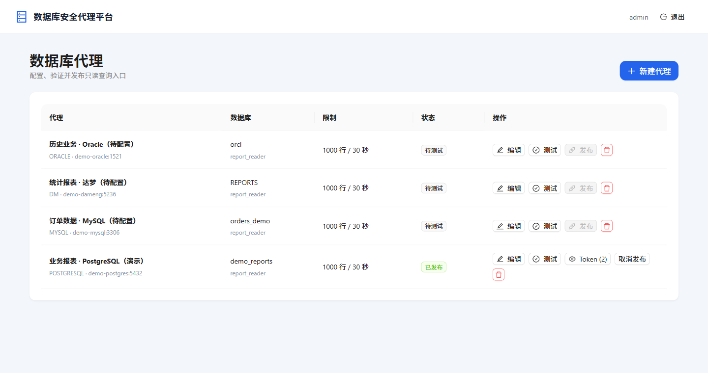
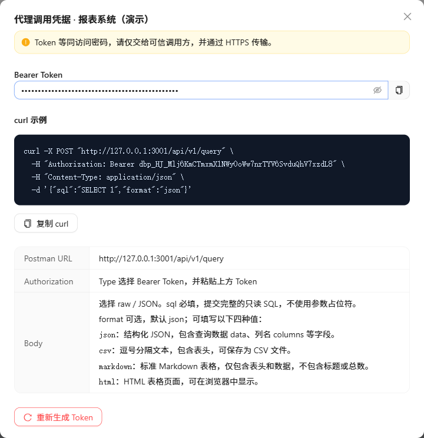

# SQL Proxy Platform · 数据库安全代理平台

**把数据库的只读查询能力，变成一个通过 Token 调用的 HTTP 接口。**

在网页中配置数据库、测试连接并发布代理，即可获得 Bearer Token 和可复制的 curl 示例。业务系统、报表脚本或 AI 工具只需提交 SQL，不必保存数据库账号、密码和连接地址，也不必安装对应的数据库驱动。

支持 **MySQL / PostgreSQL / 达梦 DM / Oracle**，提供中文管理界面，可通过单个 Docker 容器部署。

```text
业务系统 / 报表脚本 / AI 工具
           │  HTTP 请求：Token + SQL
           ▼
    SQL Proxy Platform
    认证 · 只读校验 · 超时与行数限制
           │  数据库连接仅由平台管理
           ▼
    MySQL / PostgreSQL / 达梦 / Oracle
```

> 这是数据库查询代理，不是数据库管理工具或任意 SQL 执行平台。目标数据库账号仍须配置为只读；平台检查不能替代数据库自身的权限控制。

## 界面预览

### 配置、测试和发布数据库代理

在同一页面管理数据库连接、发布状态、返回行数和超时；每个代理可以分配多个带备注的 Token。



### 复制调用示例，直接接入应用

发布后可查看调用凭据，复制 curl，并按页面说明在 Postman 中测试；支持四种查询输出格式。



*截图来自本机独立演示环境，使用虚构数据；演示 Token 已撤销，不能用于访问服务。*

## 能做什么

- **隐藏数据库凭据**：调用方只持有 Token，不接触目标数据库密码。
- **可视化发布流程**：配置 → 测试连接 → 发布；修改配置后需重新测试和发布。
- **多个 Token、独立备注**：可按应用或用途分发，分别查看、轮换和撤销。
- **只读查询**：支持 SELECT、只读 CTE、聚合和数据库原生表达式；限制多语句、写入、DDL 和加锁查询。
- **查询保护**：每个代理独立设置最大返回行数和超时，默认 1000 行、30 秒。
- **多种输出**：JSON 用于程序调用，CSV 用于导出，Markdown 用于文档，HTML 用于浏览器展示。
- **Schema 范围**：PostgreSQL、Oracle 可设置默认且允许直接查询的单个 Schema。
- **持久化与部署**：SQLite 保存配置，AES-GCM 加密数据库密码及可查看 Token；单容器运行，支持离线镜像包。

当前面向**单管理员、单实例**使用，不包含多用户/RBAC、计费或集群共享会话。

## 快速部署

### 1. 构建离线部署包

在具备 **Java 21、Maven 3.9+、Node.js 20+ 和 Docker** 的 Linux x86_64 构建机上执行；构建阶段需要访问依赖仓库。

```bash
git clone https://github.com/1BTU/sql-proxy-platform.git
cd sql-proxy-platform
bash build_x86.sh
```

产物位于 `release/`：

```text
release/
├── sql-proxy-platform.tar       # Docker 离线镜像
├── deploy.sh                   # 一键部署脚本
└── config/
    └── application-prod.yml    # 外部配置
```

### 2. 在服务器上启动

把整个 `release/` 目录复制到装有 **Docker、Compose 和 curl** 的 Linux x86_64 服务器，进入该目录执行：

```bash
bash deploy.sh
```

默认访问 **`http://服务器IP:3001`**。修改对外端口，例如使用 8080：

```bash
SERVER_PORT=8080 bash deploy.sh
```

首次部署默认账号为 `admin`，初始密码为 `Admin@123456`，**首次登录必须修改密码**。也可在首次部署时指定：

```bash
ADMIN_INITIAL_USERNAME=admin \
ADMIN_INITIAL_PASSWORD='替换为你自己的强密码' \
bash deploy.sh
```

这两个变量只控制首次初始化，不会重置已有管理员。

### 3. 发布第一个代理

1. 登录管理页面，完成初始密码修改。
2. 点击“新建代理”，填写目标数据库地址和**只读账号**。
3. 保存后点击“测试”，测试成功后点击“发布”。
4. 复制页面提供的 Token 和 curl 示例，交给需要查询数据的应用。

只重新测试、未修改配置时，已发布代理保持发布状态；修改连接配置后，已有 Token 暂停，重新测试并发布后恢复。

## 调用查询接口

**`POST /api/v1/query`**，使用请求头 `Authorization: Bearer <Token>` 认证。无需在请求中传数据库地址、账号或密码。

```bash
curl -X POST 'http://localhost:3001/api/v1/query' \
  -H 'Authorization: Bearer dbp_替换为后台生成的Token' \
  -H 'Content-Type: application/json' \
  -d '{"sql":"SELECT 1 AS result","format":"json"}'
```

Oracle 对应 SQL 请使用 `SELECT 1 AS RESULT FROM DUAL`。

请求 Body 只包含以下字段，不需要 `params` 或问号参数占位符：

| 字段 | 必填 | 说明 |
| --- | --- | --- |
| `sql` | 是 | 完整的单条只读 SQL，使用目标数据库支持的语法。 |
| `format` | 否 | 输出格式，默认 `json`，可选值如下。 |

| `format` | 返回内容 | 常见用途 |
| --- | --- | --- |
| `json` | 结构化 JSON，含 `data`、`columns` 等字段 | 业务系统、脚本、AI 工具 |
| `csv` | 包含表头的 CSV 文本 | 数据导出、电子表格 |
| `markdown` | 标准 Markdown 表格，无额外标题或总数 | 文档、报告、对话输出 |
| `html` | HTML 表格页面 | 浏览器展示 |

Postman 中选择 `POST`，Authorization 选择 `Bearer Token`，Body 选择 `raw / JSON`，填入：

```json
{"sql":"SELECT 1 AS result","format":"json"}
```

SQL 不会自动转换数据库方言。例如 Oracle 11g 使用 `ROWNUM`，不能照搬 MySQL 的 `LIMIT`。查询失败时，接口提供错误分类和错误编号，管理员可用编号查找服务端日志。

## 数据库与 Schema 说明

| 数据库 | 默认端口 | 配置提示 |
| --- | --- | --- |
| MySQL | 3306 | 填写数据库名称，使用只读账号。 |
| PostgreSQL | 5432 | Schema 可留空，或指定一个默认且允许直接查询的 Schema。 |
| 达梦 DM | 5236 | 使用达梦 JDBC 驱动，SQL 语法以目标实例为准。 |
| Oracle | 1521 | 支持 Service Name / SID，内置 JDBC Thin 驱动，无需 Oracle 客户端。 |

PostgreSQL 配置 Schema 为 `reports` 后，`FROM sales` 默认解析为 `reports.sales`，`FROM reports.sales` 也可使用；直接引用其他 Schema 返回 403。留空时由数据库账号权限和默认搜索路径决定。

Oracle 同样支持配置单 Schema；普通名称按大写规则处理，双引号名称保留大小写，允许内置测试对象 `DUAL` / `SYS.DUAL`。禁止数据库链接。

Schema 限制针对 SQL **直接引用**的对象。视图、同义词、函数内部访问仍由数据库权限决定，不保证底层数据的完全隔离。

> Oracle 11.2.0.1.0 不在当前 JDBC 驱动认证矩阵内，仍需在该版本实库验证连接和认证。项目不会自动降低数据库认证配置。Oracle JDBC 及字符集扩展版本为 `19.32.0.0`。

## 数据持久化与升级

部署目录中的以下内容必须保留，并**一起备份**：

- `data/`：SQLite 数据，包含管理员、代理及 Token 配置。
- `secrets.env`：AES 主密钥和首次初始化变量。丢失原主密钥后，历史数据库密码和 Token 无法解密。
- `config/`：自定义运行配置。

升级时替换镜像 tar 和部署脚本，在原目录重新运行 `bash deploy.sh`；不要删除或重新生成原来的 `secrets.env`。

```bash
docker logs -f sql-proxy-platform          # 查看日志
docker compose down                      # 停止容器，不删除宿主机数据
curl http://localhost:3001/api/health      # 健康检查
```

## 安全使用边界

- **必须使用数据库只读账号**，不要配置 DBA 或高权限账号；数据库权限是最终防线。
- Token 等同查询密码，应按应用分别分发；泄露时立即撤销或重新生成。
- 生产环境通过反向代理提供 **HTTPS**，并在 `config/application-prod.yml` 中开启安全 Cookie；不要直接把管理页面暴露到不可信网络。
- 密码在管理 API 中不回显；不要公开数据目录、主密钥或服务日志。
- SQL 防护不是任意数据库函数的沙箱。允许执行的函数及其副作用仍需由数据库权限限制。
- 使用或分发第三方 JDBC 驱动时，请遵守各厂商许可；仓库公开不代表第三方组件许可发生改变。

## 本地开发

技术栈：Spring Boot / Spring Security / Java 21 / SQLite，React / TypeScript / Vite / Ant Design。

后端默认监听 `3000`，部署脚本默认映射到宿主机 `3001`。

```bash
export APP_ENCRYPTION_KEY="$(openssl rand -base64 32 | tr -d '\n')"

cd frontend
npm ci
npm run build
cd ..

mkdir -p src/main/resources/static
cp -r frontend/dist/. src/main/resources/static/
mvn test package
java -jar target/dm-database-api-1.0.0.jar
```

开发时也可单独运行 `frontend` 中的 `npm run dev`，Vite 会把 `/api` 请求代理到本机 `3000`。

后端测试使用 `mvn test`；打包静态资源回归测试要求先构建并合入前端。可选 Oracle 实库测试使用 `SQL_PROXY_ORACLE_TEST_URL`、`SQL_PROXY_ORACLE_TEST_USERNAME`、`SQL_PROXY_ORACLE_TEST_PASSWORD` 环境变量，未提供实库时跳过。

当前代码版本：`v1.1.12`。
